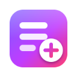

<p align="center">
  
</p>

<h1 align="center">Playlist Buttons for YouTube</h1>

<p align="center">One-click buttons on YouTube thumbnails that add videos to your playlists.</p>

<p align="center">
  <a href="https://chromewebstore.google.com/detail/playlist-buttons-for-yout/abkipmhmjcdmoeofpmmomcpfaljnihao"><strong>Install from the Chrome Web Store</strong></a>
</p>

---

A Chrome extension (Manifest V3) that puts small, colorful buttons on every YouTube video thumbnail. Each button is linked to one of your playlists: click it and the video is added through the official YouTube Data API. No menus, no "Save to playlist" dialog.

## Features

- **Buttons on every thumbnail**: home, subscriptions, search, channel pages, the watch-page sidebar, playlists and Shorts. The video you're watching gets the buttons above its title.
- **As many buttons as you want**, each with its own label, color and target playlist.
- **Duplicate check**: a video that's already in the playlist isn't added again.
- **Clear feedback**: the button pulses while working, then shows ✓ on success or ! on error, plus a toast message.
- **Auto-save settings** that apply right away to open YouTube tabs and sync across your Chrome browsers.
- **On/off switch** to hide all buttons without losing your setup.
- **Trash shortcut** on your playlist pages to remove a video in one click (English and Portuguese YouTube).

## Installation

Install it from the [Chrome Web Store](https://chromewebstore.google.com/detail/playlist-buttons-for-yout/abkipmhmjcdmoeofpmmomcpfaljnihao), then pin it to the toolbar from Chrome's extensions menu (puzzle icon).

## Usage

1. Click the extension icon in the toolbar.
2. Click **+ Add button**, then set:
   - a **label** (e.g. `Music`),
   - a **color**,
   - the **playlist ID**: open the playlist on YouTube and copy the part of the URL after `list=` (usually starts with `PL`).
3. Browse YouTube. Click a button on any thumbnail to add that video.

The first click asks you to sign in with Google and allow access to your YouTube account.

## Installing for development

1. Clone the repository.
2. Open `chrome://extensions`, turn on **Developer mode**, click **Load unpacked** and select the project folder.

Google sign-in only works when the extension ID matches the OAuth client in `manifest.json` (type **Chrome Extension** in Google Cloud). The client in the manifest is registered for the Chrome Web Store item ID. To test sign-in from an unpacked copy, add the item's public key (Developer Dashboard → Package → *View public key*) as `"key"` in your local `manifest.json`, so the unpacked copy gets the same ID. **Don't commit or upload the `key` field**: `package.ps1` refuses to build with it.

## Packaging for the Chrome Web Store

```powershell
.\package.ps1
```

Creates `dist/playlist-buttons-for-youtube-<version>.zip` with only the runtime files. Bump `version` in `manifest.json` before each store upload.

## Project structure

| File | Purpose |
|---|---|
| `manifest.json` | Extension manifest (permissions, OAuth client and scope, icons) |
| `background.js` | Service worker: Google sign-in and YouTube Data API calls |
| `contentScript.js` | Adds the buttons to YouTube thumbnails and the playlist-page trash shortcut |
| `styles.css` | Styles for the buttons, overlay and toasts injected into YouTube |
| `popup.html` / `popup.js` | Settings popup: buttons list, auto-save and on/off switch |
| `icons/` | Extension icons (`icon.svg` is the source artwork) |
| `docs/privacy-policy.md` | Privacy policy, published with GitHub Pages |
| `package.ps1` | Builds the Web Store zip |

## Permissions

| Permission | Why |
|---|---|
| `storage` | Saves your button settings (synced across your Chrome browsers) |
| `identity` | Google sign-in to call the YouTube Data API |
| `youtube.com` | Shows the buttons on YouTube pages |
| `googleapis.com` | Calls the YouTube Data API v3 |
| OAuth scope `youtube` | Required to add items to your playlists |

## API quota

The YouTube Data API has a default quota of 10,000 units per day per Google Cloud project, shared by all users. Each add costs about 51 units (50 for the insert, 1 for the duplicate check), so roughly 190 adds per day in total.

## Privacy

The extension has no servers, collects no browsing data and has no ads or analytics. Your sign-in is used only to call the YouTube Data API when you click a button. Read the full [privacy policy](https://lorenzofeldens.github.io/Extension-Youtube/privacy-policy).

## Disclaimer

This extension is not affiliated with, endorsed by, or sponsored by YouTube or Google LLC. YouTube is a trademark of Google LLC.
